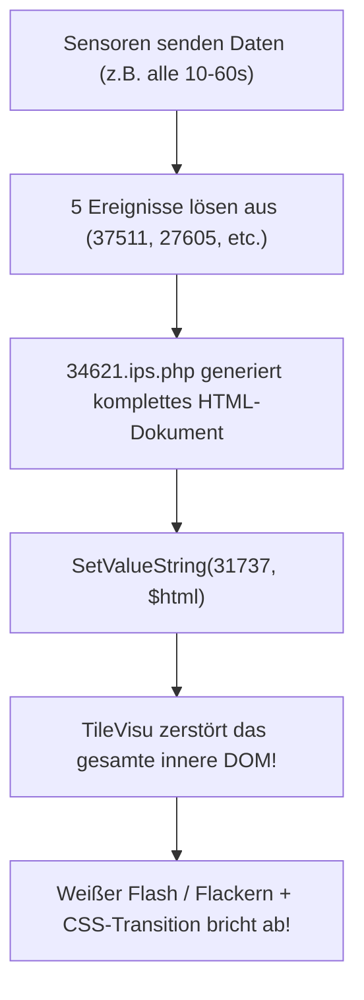
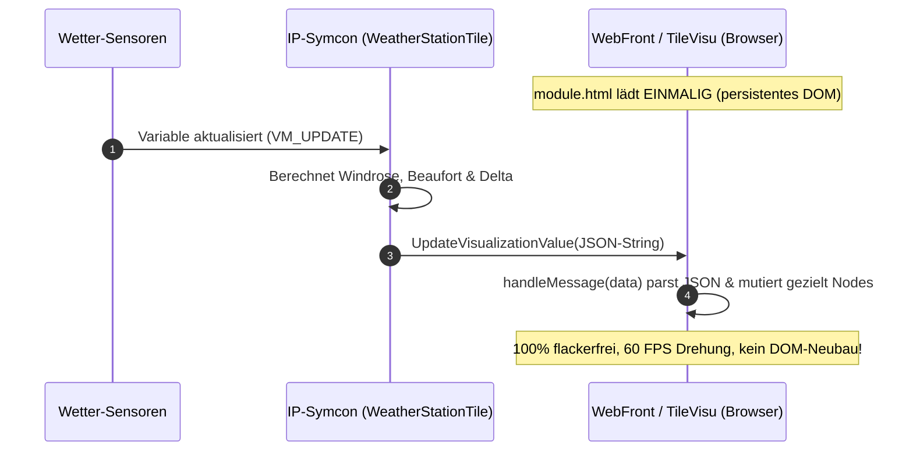

# IPS-Tile-Visu

[](https://www.symcon.de)
[](LICENSE)

Umfassende Modul-Bibliothek und Entwickler-Vorlage für **moderne, flackerfreie Kachel-Visualisierungen** in IP-Symcon ab Version 7.1 (getestet bis IP-Symcon 9.0) unter Verwendung des offiziellen **HTML-SDKs**.

Inspiriert durch das Konzept von [*da8ter/TileVisu-Universelle-Geraete-Kachel*](https://github.com/da8ter/TileVisu-Universelle-Geraete-Kachel).

---

## Inhaltsverzeichnis

1. [Enthaltene Module](#enthaltene-module)
2. [Problemanalyse: Warum flackert die bisherige Visualisierung?](#problemanalyse-warum-flackert-die-bisherige-visualisierung)
3. [Die Lösung: Das IP-Symcon HTML-SDK](#die-lösung-das-ip-symcon-html-sdk)
4. [Live-Datenfluss & Synchronisation (Mobile & Desktop)](#live-datenfluss--synchronisation-mobile--desktop)
5. [Installation & Deployment](#installation--deployment)
6. [Konfiguration der Wetterstation (IDs aus dem System)](#konfiguration-der-wetterstation-ids-aus-dem-system)
7. [Detailansicht & Vollbildmodus](#detailansicht--vollbildmodus)
8. [Sofort-Hilfe für das alte Skript (Legacy-Fix)](#sofort-hilfe-für-das-alte-skript-legacy-fix)

---

## Enthaltene Module

```text
IPS-Tile-Visu/
├── library.json
├── README.md
├── TileTemplate/             <-- Universelles Kachel-Template (HTML-SDK Starter-Kit)
│   ├── module.json
│   ├── module.php
│   ├── module.html
│   ├── form.json
│   ├── locale.json
│   └── README.md
├── WeatherStationTile/       <-- Dediziertes Wetterstations-Modul (flackerfrei, responsive)
│   ├── module.json
│   ├── module.php
│   ├── module.html
│   ├── form.json
│   ├── locale.json
│   └── README.md
├── GarageDoorTile/           <-- Smarte Garagentor-Kachel (Shelly 1 Tasterimpuls, SVG Sektionaltor)
│   ├── module.json
│   ├── module.php
│   ├── module.html
│   ├── form.json
│   ├── locale.json
│   └── README.md
└── scripts/
    └── 34621_windrose_legacy_optimized.php  <-- Optimierter Legacy-Fix für unserver
```

### 1. `TileTemplate`
Ein sauberes, schlankes Entwickler-Starterkit zur Erstellung beliebiger eigener Kacheln mit dem IP-Symcon HTML-SDK:
- `$this->SetVisualizationType(1)` aktiviert natives HTML-Rendering.
- CSS Container Queries (`@container`), Dark/Light-Mode und flüssige Animationen.
- Bidirektionale Interaktion über `requestAction(ident, val)` in JavaScript und `RequestAction()` in PHP.
- Robuster Nachrichten-Empfang für geparste Objekte und JSON-Strings.

### 2. `WeatherStationTile`
Speziell für Wetterstationen (TFA Dostmann, WeatherHub, Netatmo, Davis Instruments etc.) optimierte Kachel:
- **Flackerfreie Vektor-Windrose (SVG)**: Hardware-beschleunigte 60-FPS Drehung der Windnadel mit automatischer Kürzester-Weg-Berechnung (keine 350°-Rückwärtsdreher über Nord!).
- **Geisterzeiger**: Zeigt die vorherige Windrichtung dezent an, um Drehungen sofort zu erkennen.
- **Einheiten-Wahl**: Frei konfigurierbar in km/h, m/s oder Knoten.
- **Beaufort-Skala**: Automatische Berechnung (0–12 Bft) mit deutscher Klartext-Bezeichnung (z. B. *Windstille*, *Frische Brise*).
- **Zwei Temperaturzonen**: Außentemperatur (z. B. Wärmepumpen-Fühler) groß im Fokus + Stall-/Zusatztemperatur stabil verankert.
- **Böen-Warnung**: Bernstein-Akzent (`#F59E0B`), sobald Böen über 0 km/h gemessen werden.
- **Regen-Badge**: Automatische Einblendung bei Regen; eingeklappt bei trockenem Wetter.
- **Transparente Farbanpassung**: Nahtlose Verschmelzung mit der Hintergrundfarbe nativer Symcon-Kacheln (`#333438`).

### 3. `GarageDoorTile`
Smarte Kachel-Visualisierung und Steuerung für Garagentore:
- **Automatische Taster-Simulation (Shelly 1 / Plus 1)**: Löst das Problem, dass herkömmliche Schalter dauerhaft auf *Ein* verbleiben. Sendet einen sauberen Impuls (z.B. 800 ms) und setzt das Relais über einen non-blocking Modul-Timer wieder auf *Aus*.
- **Dynamisches SVG-Sektionaltor**: Animierte Lamellen heben und senken sich proportional zum Öffnungsgrad (0–100%) und gewähren Einblick in das beleuchtete Garageninnere.
- **1-Taster State-Machine**: Verwaltet die Fahrzyklen `Geschlossen` $\rightarrow$ `Wird geöffnet...` $\rightarrow$ `Gestoppt` $\rightarrow$ `Wird geschlossen...` $\rightarrow$ `Gestoppt` mit Live-Bewegungspfeilen.
- **Endlagen-Kalibrierung**: Synchronisiert sich mit dem physischen Sensor (z.B. Magnetschalter an Shelly Pro 4PM) und setzt die Position bei `Geschlossen` sofort auf 0% zurück.
- **Offen-Dauer & Warnung**: Zählt die Öffnungsdauer mit und warnt farblich bei lang offenstehendem Tor (z.B. > 30 Min.).
- **Online-Status**: Erkennt den Erreichbarkeitsstatus des Aktors.

---

## Problemanalyse: Warum flackert die bisherige Visualisierung?

Auf dem Unraid-Server `unserver` lief die Visualisierung bisher über das Skript **`34621.ips.php`**, welches den gesamten HTML/CSS/SVG-Code als String in die Variable **`31737`** (`Windrose`, Typ `String` mit Profil `~HTMLBox`) geschrieben hat:



### Die 3 Hauptursachen für das Flackern:

1. **DOM-Zerstörung bei jedem Aufruf:**
   Wird eine `~HTMLBox`-Variable per `SetValueString()` beschrieben, löscht das Frontend von IP-Symcon das bestehende DOM-Element und erzeugt es neu. Der Browser muss Stylesheet, Layout und SVG jedes Mal komplett neu berechnen.
2. **Abbruch von CSS-Transitions:**
   In `34621.ips.php` war eine CSS-Transition hinterlegt (`transition: transform 0.6s`). Da das `<g>`-Element bei jedem Update gelöscht und mit dem neuen Winkel neu gerendert wurde, konnte der Browser keine weiche Drehung animieren — die Nadel sprang unruhig.
3. **Ereignis-Typ "Bei Aktualisierung":**
   Drei der fünf Ereignisse (`37511` Außentemperatur, `27605` Stalltemperatur, `50140` Böe) standen auf *"Bei Aktualisierung"*. Das bedeutet: Jedes Mal, wenn ein Funkpaket empfangen wurde (selbst wenn die Temperatur identisch war), lief das Skript und erzwang einen Neurender.

---

## Die Lösung: Das IP-Symcon HTML-SDK

Im Modul `WeatherStationTile` wird das native **HTML-SDK** von IP-Symcon eingesetzt:



---

## Live-Datenfluss & Synchronisation (Mobile & Desktop)

Ein wichtiger Aspekt des IP-Symcon HTML-SDKs ist die Unterscheidung zwischen dem **initialen Laden** und **Live-Updates**:

| Phase | Übertragungsweg | Datentyp in `handleMessage(data)` |
|---|---|---|
| **Initiales Laden** | Inline `<script>window.__INITIAL_DATA__ = {...};</script>` | Direktes **JavaScript-Objekt** |
| **Live-Update (WebSocket)** | `$this->UpdateVisualizationValue(json_encode(...))` | **JSON-String** |

### Warum fehlten zuvor Werte auf dem Desktop?
Wird `handleMessage(data)` aufgerufen, muss zwingend geprüft werden, ob `data` ein String ist:
```javascript
function handleMessage(data) {
    if (!data) return;

    if (typeof data === 'string') {
        try {
            data = JSON.parse(data);
        } catch (e) {
            console.error('JSON parse error:', e);
            return;
        }
    }
    // Gezielte Mutation der Nodes
}
```
Ohne diese Deserialisierung griff JavaScript bei Live-Pushes ins Leere (`data.secondaryTempFormatted` war `undefined`), wodurch Stalltemperatur, Böen und Beaufort fälschlicherweise ausgeblendet wurden. Durch die integrierte Deserialisierung bleiben Desktop und Mobile nun permanent synchron.

---

## Installation & Deployment

### 1. In IP-Symcon einbinden
1. In der IP-Symcon Verwaltungskonsole auf `Kern-Instanzen` -> `Modules` gehen.
2. Auf **Hinzufügen** klicken und die URL eintragen:
   ```text
   https://gitea.local.lan/thomas/IPS-Tile-Visu.git
   ```
   *(oder von GitHub: `https://github.com/TtodaH/IPS-Tile-Visu.git`)*
3. In der gewünschten Kategorie auf **Instanz hinzufügen** klicken und nach **"Weather Station Tile"** suchen.

### 2. Git & CLI-Richtlinien (Server & Entwickler)
* **Lokales Subnetz:** `192.168.10.0/24`.
* **Symcon Server:** `unserver` (`192.168.10.9`), Modulpfad: `/mnt/user/ips/data/modules/IPS-Tile-Visu`.
* **Keine Bestätigungs-Popups (macOS Keychain / SSH):**
  - Für GitHub immer die `gh` CLI verwenden (`gh auth setup-git`).
  - Für Gitea immer die `gt` CLI verwenden (`gt auth setup-git`).
  - Beide Remotes nutzen sichere HTTPS-Helper ohne Passphrase-Abfragen:
    ```bash
    git push origin main    # Gitea
    git push github main    # GitHub
    ```

---

## Konfiguration der Wetterstation (IDs aus dem System)

Trage in der Instanzkonfiguration der **Weather Station Tile** (Instanz-ID `29926`) die folgenden IDs deines Systems ein:

| Parameter | ID | Name laut System |
|---|---|---|
| **Windrichtung** | `38465` | TFA2\Wetterstation\Aktuelle Windrichtung (Grad) |
| **Windgeschwindigkeit** | `21228` | TFA2\Wetterstation\Aktuelle Windgeschwindigkeit (m/s) |
| **Windböe** | `58720` | TFA2\Wetterstation\Aktuelle Böe (m/s) |
| **Vorherige Windrichtung** | `44797` | TFA2\Wetterstation\Vorherige Windrichtung |
| **Außentemperatur** | `13145` | Heat Pump\Temperatur_TA_Aussenfuehler |
| **Zusatz-Temperatur** | `31094` | TFA2\Kaninchenstall\Aktuelle Temperatur |
| **Regen-/Trockensensor** | `35022` | TFA2\Wetterstation\Aktuell trocken |
| **Batteriestatus** | `15523` | TFA2\Wetterstation\Batterie |

---

## Detailansicht & Vollbildmodus

Das Modul pflegt unterhalb der Instanz automatisch native Statusvariablen (`MaintainVariable`):

* **Außentemperatur** (`~Temperature`)
* **Windgeschwindigkeit** (`~WindSpeed.ms`)
* **Böe** (`~WindSpeed.ms`)
* **Windrichtung** (`~WindDirection.Text`)
* **Stall** (`~Temperature`)
* **Regen** (`~Raining`)
* **Batterie** (`~Battery.Reversed`)

Beim Klick auf das native Vollbild-/Detail-Symbol (`⤢`) oben rechts an der Kachel öffnet IP-Symcon eine übersichtliche Detailseite mit allen Einzelwerten, Verlaufsgraphen und Status-Icons, inklusive des Batteriezustands.

---

## Sofort-Hilfe für das alte Skript (Legacy-Fix)

Falls das historische Skript `34621.ips.php` parallel als Rückfallebene beruhigt werden soll:

1. **Ereignisse umstellen**: Ändere die Ereignisse `37511`, `27605` und `50140` von *"Bei Aktualisierung"* auf *"Bei Änderung"*.
2. **Anti-Flacker-Bremse im Skript**: Ersetze das `SetValueString($htmlID, $html);` durch:
   ```php
   if (GetValueString($htmlID) !== $html) {
       SetValueString($htmlID, $html);
   }
   ```
   *(Vollständige Vorlage: [`scripts/34621_windrose_legacy_optimized.php`](file:///Users/thomas/projectsgit/PHP/IPS-Tile-Visu/scripts/34621_windrose_legacy_optimized.php))*
