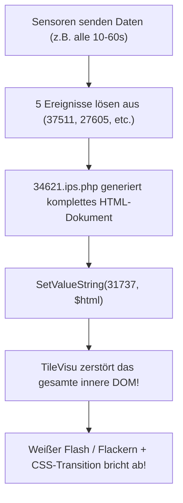
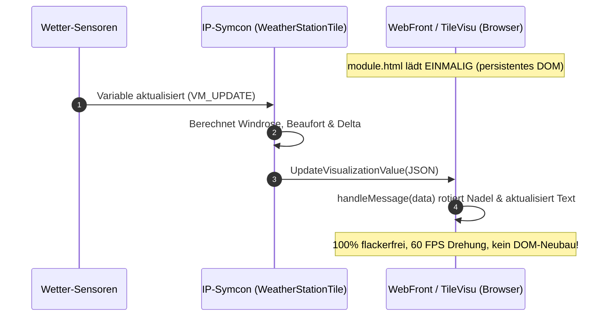

# IPS-Tile-Visu

[](https://www.symcon.de)
[](LICENSE)

Umfassende Modul-Bibliothek und Entwickler-Vorlage für **moderne, flackerfreie Kachel-Visualisierungen** in IP-Symcon ab Version 7.1 (HTML-SDK).

Inspiriert durch das Konzept von [*da8ter/TileVisu-Universelle-Geraete-Kachel*](https://github.com/da8ter/TileVisu-Universelle-Geraete-Kachel).

---

## Inhaltsverzeichnis

1. [Enthaltene Module](#enthaltene-module)
2. [Problemanalyse: Warum flackert die bisherige Visualisierung?](#problemanalyse-warum-flackert-die-bisherige-visualisierung)
3. [Die Lösung: Das IP-Symcon HTML-SDK](#die-lösung-das-ip-symcon-html-sdk)
4. [Installation in IP-Symcon](#installation-in-ip-symcon)
5. [Konfiguration der Wetterstation (IDs aus Screenshot)](#konfiguration-der-wetterstation-ids-aus-screenshot)
6. [Sofort-Hilfe für das bestehende Skript (Legacy-Fix)](#sofort-hilfe-für-das-bestehende-skript-legacy-fix)

---

## Enthaltene Module

```text
IPS-Tile-Visu/
├── library.json
├── README.md
├── TileTemplate/             <-- Universelles Kachel-Template (HTML-SDK Starter-Kit)
│   ├── module.json
│   ├── module.php
│   ├── module.html
│   ├── form.json
│   ├── locale.json
│   └── README.md
├── WeatherStationTile/       <-- Dediziertes Wetterstations-Modul (flackerfrei)
│   ├── module.json
│   ├── module.php
│   ├── module.html
│   ├── form.json
│   ├── locale.json
│   └── README.md
└── scripts/
    └── 34621_windrose_legacy_optimized.php  <-- Optimierter Legacy-Fix für unserver
```

### 1. `TileTemplate`
Ein sauberes, schlankes Entwickler-Template zur Erstellung beliebiger eigener Kacheln mit dem IP-Symcon 7.1+ HTML-SDK:
- `$this->SetVisualizationType(1)` aktiviert natives HTML-Rendering.
- CSS Container Queries (`@container`), Dark/Light-Mode und flüssige Animationen.
- Bidirektionale Interaktion über `requestAction()` in JavaScript und `RequestAction()` in PHP.

### 2. `WeatherStationTile`
Speziell für Wetterstationen (TFA WeatherHub, Netatmo, Davis etc.) entwickelte Kachel:
- **Flackerfreie Vektor-Windrose (SVG)**: Hardware-beschleunigte 60-FPS Drehung der Windnadel mit automatischer Kürzester-Weg-Berechnung (keine 350°-Rückwärtsdreher über Nord!).
- **Geisterzeiger**: Zeigt die vorherige Windrichtung dezent an, um Drehungen sofort zu erkennen.
- **Einheiten-Wahl**: Frei konfigurierbar in km/h, m/s oder Knoten.
- **Beaufort-Skala**: Automatische Berechnung (0–12 Bft) mit deutscher Klartext-Bezeichnung (z. B. *Frische Brise*).
- **Zwei Temperaturzonen**: Außentemperatur (z. B. Wärmepumpen-Fühler) groß im Fokus + Stall-/Zusatztemperatur.
- **Status-Badges**: Automatische Warnanzeigen für Regen/Trockenheit und Batteriezustand.

---

## Problemanalyse: Warum flackert die bisherige Visualisierung?

Auf deinem Unraid-Server `unserver` läuft die Visualisierung bisher über das Skript **`34621.ips.php`**, welches den gesamten HTML/CSS/SVG-Code in die Variable **`31737`** (`Windrose`, Typ `String` mit Profil `~HTMLBox`) schreibt:



### Die 3 Hauptursachen für das Flackern:

1. **DOM-Zerstörung bei jedem Aufruf:**
   Wird eine `~HTMLBox`-Variable per `SetValueString()` beschrieben, löscht das Frontend von IP-Symcon das bestehende DOM-Element und erzeugt es neu. Der Browser muss Stylesheet, Layout und SVG jedes Mal komplett neu berechnen.
2. **Abbruch von CSS-Transitions:**
   In `34621.ips.php` ist eine CSS-Transition hinterlegt (`transition: transform 0.6s`). Da das `<g>`-Element bei jedem Update gelöscht und mit dem neuen Winkel neu gerendert wird, kann der Browser keine weiche Drehung animieren — die Nadel "springt" oder zuckt.
3. **Ereignis-Typ "Bei Aktualisierung":**
   Drei der fünf Ereignisse (`37511` Außentemperatur, `27605` Stalltemperatur, `50140` Böe) standen auf *"Bei Aktualisierung"*. Das bedeutet: Jedes Mal, wenn ein Funkpaket empfangen wird (selbst wenn die Temperatur exakt identisch ist), läuft das Skript und erzwingt einen Neurender.

---

## Die Lösung: Das IP-Symcon HTML-SDK

Im neuen Modul `WeatherStationTile` wird das native **HTML-SDK** von IP-Symcon 7.1+ eingesetzt:



---

## Installation in IP-Symcon

### Weg A: Über lokales Gitea (Empfohlen)
1. Im IP-Symcon WebFront / Management Console auf `Modul-Control` gehen (`Kern-Instanzen` -> `Modules`).
2. Auf **Hinzufügen** klicken und die URL eintragen:
   ```text
   git@gitea.local.lan:thomas/IPS-Tile-Visu.git
   ```
   *(Alternativ: `https://gitea.local.lan/thomas/IPS-Tile-Visu`)*
3. Nach dem Laden in der Objektbaum-Ansicht auf **Instanz hinzufügen** klicken:
   - Für die Wetterstation: Suche nach **"Weather Station Tile"** (oder *Wetterstation Kachel*).
   - Für das Template: Suche nach **"Tile Template"**.

---

## Konfiguration der Wetterstation (IDs aus Screenshot)

Trage in der Instanzkonfiguration der **Weather Station Tile** die folgenden IDs aus deinem System ein:

| Parameter | ID | Name laut System |
|---|---|---|
| **Windrichtung** | `38465` | TFA2\Wetterstation\Aktuelle Windrichtung (Grad) |
| **Windgeschwindigkeit** | `21228` | TFA2\Wetterstation\Aktuelle Windgeschwindigkeit (m/s) |
| **Windböe** | `58720` | TFA2\Wetterstation\Aktuelle Böe (m/s) |
| **Vorherige Windrichtung** | `44797` | TFA2\Wetterstation\Vorherige Windrichtung |
| **Außentemperatur** | `13145` | Heat Pump\Temperatur_TA_Aussenfuehler |
| **Zusatz-Temperatur** | `31094` | TFA2\Kaninchenstall\Aktuelle Temperatur |
| **Regen-/Trockensensor** | `35022` | TFA2\Wetterstation\Aktuell trocken |
| **Batteriestatus** | `15523` | TFA2\Wetterstation\Batterie |

Sobald eingerichtet, bindest du die Modul-Instanz direkt in deine Kachel-Visualisierung ein. Die alte HTMLBox-Variable `31737` und das Aktualisierungsskript `34621` werden dann nicht mehr benötigt!

---

## Sofort-Hilfe für das bestehende Skript (Legacy-Fix)

Falls du bis zur Umstellung auf das Modul das bisherige Skript `34621.ips.php` auf deinem Server `unserver` beruhigen möchtest:

1. **Ereignisse umstellen**: Ändere die Ereignisse `37511`, `27605` und `50140` in der IP-Symcon Konsole von *"Bei Aktualisierung"* auf *"Bei Änderung"*.
2. **Anti-Flacker-Bremse im Skript**: Ersetze das `SetValueString($htmlID, $html);` am Ende von `34621.ips.php` durch:
   ```php
   if (GetValueString($htmlID) !== $html) {
       SetValueString($htmlID, $html);
   }
   ```
   *(Eine vollständige, optimierte Version findest du unter [`scripts/34621_windrose_legacy_optimized.php`](file:///Users/thomas/projectsgit/PHP/IPS-Tile-Visu/scripts/34621_windrose_legacy_optimized.php))*
