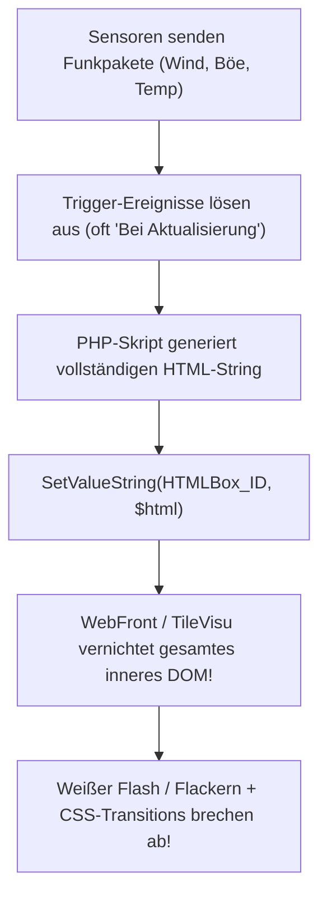
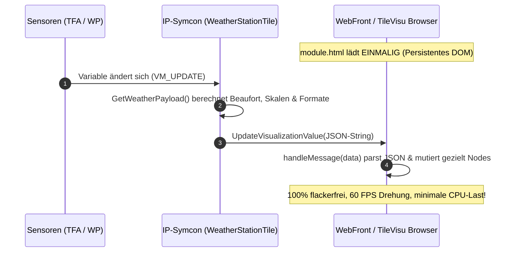

# Weather Station Tile (Wetterstation Kachel)

[](https://www.symcon.de)
[](../LICENSE)

Moderne, performante und **100% flackerfreie** Kachel-Visualisierung für IP-Symcon ab Version 7.1 (getestet bis IP-Symcon 9.0), basierend auf dem nativen **HTML-SDK**. Entwickelt für Wetterstationen (TFA Dostmann, WeatherHub, Netatmo, Davis Instruments etc.).

---

## Inhaltsverzeichnis

1. [Problemanalyse: Warum flackert die bisherige Visualisierung?](#problemanalyse-warum-flackert-die-bisherige-visualisierung)
2. [Architektur & Funktionsweise (HTML-SDK)](#architektur--funktionsweise-html-sdk)
3. [Features & Design](#features--design)
4. [Responsive Layout & Styling](#responsive-layout--styling)
5. [Konfiguration & Variablen-Zuordnung](#konfiguration--variablen-zuordnung)
6. [Detailansicht & Vollbildmodus](#detailansicht--vollbildmodus)
7. [Fehlerbehebung & Best Practices](#fehlerbehebung--best-practices)

---

## Problemanalyse: Warum flackert die bisherige Visualisierung?

In der klassischen IP-Symcon Implementierung (z. B. Skript `34621.ips.php` und Variable `31737` als `~HTMLBox`) tritt bei jedem Sensor-Update starkes Flackern auf:



### Die 3 Kernursachen des Flackerns:

1. **Vollständiger DOM-Abbruch:**
   Jedes `SetValueString()` auf eine `~HTMLBox`-Variable veranlasst das Frontend, den gesamten DOM-Baum der Kachel zu zerstören und neu aufzubauen. Stylesheet, Layout und SVG müssen jedes Mal neu berechnet und gerendert werden.
2. **Abbruch von CSS-Transitions:**
   In Animationen hinterlegte Übergänge (`transition: transform 0.8s`) können nicht flüssig ablaufen, da das rotierende SVG-Element bei jedem Update gelöscht und mit dem neuen statischen Winkel neu gezeichnet wird — die Nadel springt oder zuckt unschön.
3. **Ereignis-Typ "Bei Aktualisierung":**
   Werden Ereignisse auf *"Bei Aktualisierung"* konfiguriert, feuert das Skript bei jedem empfangenen Funktelegramm — selbst wenn Temperatur oder Windgeschwindigkeit unverändert sind.

---

## Architektur & Funktionsweise (HTML-SDK)

Das Modul `WeatherStationTile` nutzt die offizielle **HTML-SDK Schnittstelle** (`SetVisualizationType(1)`):



### Der Datenfluss im Detail:

1. **Initiales Rendern:**
   Beim ersten Aufruf liefert `GetVisualizationTile()` das HTML-Dokument (`module.html`). Das Skript bindet `window.__INITIAL_DATA__` direkt ein, sodass die Kachel sofort mit aktuellen Messwerten gezeichnet wird — ohne Ladeverzögerung.
2. **Live-Updates ohne Neuladen:**
   Ändert sich ein Sensorwert, empfängt `MessageSink` das `VM_UPDATE`-Signal und ruft `SendTileUpdate()` auf.
   `$this->UpdateVisualizationValue(json_encode($payload))` sendet ein schlankes JSON-Paket über den IP-Symcon WebSocket an den Browser.
3. **Selektive DOM-Mutation in JavaScript:**
   `handleMessage(data)` nimmt die Nachricht entgegen.
   - Falls `data` als JSON-String ankommt (Standard bei WebSocket-Pushes), wird es automatisch über `JSON.parse(data)` deserialisiert.
   - Es werden **nur** die jeweiligen `textContent`-Werte und die CSS-Eigenschaft `transform: rotate(...)` aktualisiert. Der DOM-Baum bleibt dauerhaft stabil.

---

## Features & Design

* **Flackerfreie Vektor-Windrose (SVG)**:
  - Hochauflösende Skala mit Hauptstrichen (N, O, S, W) und Zwischenmarkierungen (NO, SO, SW, NW).
  - Farbiger Nordmarker (Standard: Rosarot `#F43F5E`) zur schnellen Orientierung.
  - Zweifarbige Windnadel mit Tiefeneffekt und Schatten (`feDropShadow`).
* **Intelligente Kürzester-Weg-Rotation (Continuous Rotation)**:
  - Die Funktion `calculateContinuousRotation(targetAngle, currentAngle)` verhindert 350°-Rückwärtsdreher beim Überschreiten der Nordgrenze (z. B. von 355° auf 5°). Die Nadel dreht elegant die kürzesten 10° im Uhrzeigersinn.
* **Geisterzeiger (Vorherige Windrichtung)**:
  - Ein dezenter, teiltransparenter Zeiger visualisiert die vorherige Windrichtung. Dreht sich der Wind, ist die Tendenz sofort erkennbar.
* **Beaufort-Skala mit Klartext**:
  - Automatische Berechnung von 0 (*Windstille*) bis 12 (*Orkan*) anhand der meteorologischen Grenzwerte (m/s).
* **Zwei Temperaturzonen im Footer**:
  - **Außentemperatur**: Große Hero-Anzeige links (z. B. Außenfühler der Wärmepumpe).
  - **Zusatz-Temperatur**: Rechts verankert mit konfigurierbarem Label (z. B. *Stall: 4,8 °C*).
* **Windgeschwindigkeit & Böen**:
  - Geschwindigkeit in blauer Akzentfarbe (`#38BDF8`).
  - Böenanzeige in bernsteinfarbenem Akzent (`#F59E0B`), sobald Böen über 0 km/h gemessen werden.
* **Regenwarnung**:
  - Blend-In Status-Badge oben links, das nur bei aktivem Regen eingeblendet wird. Bei trockenem Wetter bleibt die Kopfzeile platzsparend eingeklappt (`0px`).
* **Nahtlose Farbintegration**:
  - `background: transparent;` sorgt dafür, dass die Kachel exakt die native Hintergrundfarbe von IP-Symcon Standard-Kacheln übernimmt (`#333438` im Dark Mode).
  - Das SVG-Ziffernblatt verwendet dezente Alpha-Schichtungen (`rgba(255,255,255,0.04)` und `rgba(0,0,0,0.12)`), sodass kein harter Farbrand entsteht.

---

## Responsive Layout & Styling

Die Kachel verwendet ein **vollständig flexibles Flexbox-Layout**, das ein Abschneiden von Messwerten bei jeglichen Kachelgrößen und Endgeräten verhindert:

```text
┌────────────────────────────────────────────────────────┐
│  wr-top-bar (flex: 0 0 auto)                           │  <- Regenwarnung (nur bei Regen)
├────────────────────────────────────────────────────────┤
│  wr-compass-section (flex: 1 1 0; min-height: 0)       │
│    ├── wr-compass-hero (flex: 1 1 0; min-height: 0)    │  <- SVG skaliert proportional
│    │     └── <svg class="wr-svg" viewBox="0 0 120 120">│
│    └── wr-cardinal-badge (flex: 0 0 auto)              │  <- z.B. "SSW (203°) · Süd-Südwest"
├────────────────────────────────────────────────────────┤
│  wr-divider (flex: 0 0 auto; height: 1px)              │  <- Subtile Trennlinie
├────────────────────────────────────────────────────────┤
│  wr-footer (flex: 0 0 auto)                            │  <- Bleibt IMMER verankert!
│    ├── Reihe 1: 6,1 °C AUSSEN          Stall: 4,8 °C   │
│    └── Reihe 2: 0,4 km/h Böe 2,9 km/h  0 Bft (Wind...) │
└────────────────────────────────────────────────────────┘
```

### Besondere Ansichten:
* **Standard-Kachel (Hochformat / Quadratisch):** Vertikales Flexbox-Layout. Die Windrose schrumpft bei geringer Kachelhöhe elastisch, der Footer bleibt stets zu 100% sichtbar.
* **Breites Kachelformat (2 Spalten):**
  Über Media-Query `@media (min-width: 420px) and (max-height: 340px)` ordnen sich Windrose (links) und Messwerte (rechts) automatisch zweispaltig an.

---

## Konfiguration & Variablen-Zuordnung

Trage in der Instanzkonfiguration der **Weather Station Tile** (Instanz-ID `29926`) die Variablen deines Systems ein:

| Parameter | ID (Beispiel TFA) | Typ | Beschreibung |
|---|---|---|---|
| **WindDirectionVariable** | `38465` | Float (Grad) | Aktuelle Windrichtung (0–360°) |
| **WindSpeedVariable** | `21228` | Float (m/s) | Aktuelle Windgeschwindigkeit |
| **GustVariable** | `58720` | Float (m/s) | Aktuelle Böe |
| **PreviousDirectionVariable** | `44797` | Float (Grad) | Vorherige Windrichtung (Geisterzeiger) |
| **OutdoorTempVariable** | `13145` | Float (°C) | Haupt-Außentemperatur (z. B. Wärmepumpe) |
| **SecondaryTempVariable** | `31094` | Float (°C) | Zusatztemperatur (z. B. Kaninchenstall) |
| **RainVariable** | `35022` | Boolean | Regen-/Trockensensor (*Aktuell trocken*) |
| **BatteryVariable** | `15523` | Boolean | Batteriestatus |

### Anzeige-Optionen:
* **Kacheltitel**: z. B. `Wetterstation`.
* **Haupteinheit für Wind**: `km/h`, `m/s` oder `kn` (Knoten).
* **Beaufort-Skala anzeigen**: Ein-/Ausschaltbar.
* **Zusatz-Temperatur anzeigen**: Ein-/Ausschaltbar (Beschriftung frei wählbar, z. B. *Stall*).
* **Regenstatus anzeigen**: Zeigt Regen-Badge bei Niederschlag.
* **Batteriestatus anzeigen**: Auf der Kachel standardmäßig `Aus` (Batteriewert bleibt in der Detailansicht verfügbar).
* **Vorherige Windrichtung**: Geisterzeiger ein-/ausblendbar.
* **Farben**: Windnadel, Nordmarker und Böenanzeige frei konfigurierbar.

---

## Detailansicht & Vollbildmodus

Das Modul registriert in `ApplyChanges()` über `MaintainVariable` automatisch saubere Child-Statusvariablen unterhalb der Modul-Instanz:

* `OutdoorTemperature` (Profil `~Temperature`)
* `WindSpeed` (Profil `~WindSpeed.ms`)
* `Gust` (Profil `~WindSpeed.ms`)
* `WindDirection` (Profil `~WindDirection.Text`)
* `SecondaryTemperature` (Profil `~Temperature`)
* `Rain` (Profil `~Raining`, invertiert TFA *"Aktuell trocken"*)
* `Battery` (Profil `~Battery.Reversed`)

**Vorteil:**
Beim Klick auf das native Vollbild-/Detail-Symbol (`⤢`) oben rechts an der Kachel öffnet IP-Symcon eine übersichtliche Detailseite mit allen Einzelwerten, Verlaufsgraphen und Status-Icons, inklusive des Batteriezustands.

---

## Fehlerbehebung & Best Practices

### 1. Nach Updates Werte auf dem Desktop nicht sichtbar?
Wird der Code auf dem Server aktualisiert, hält der Desktop-Browser oft noch die vorherige HTML-Version im Speicher.
* **Lösung:** Einmaliger Hard Reload im Browser mit `Cmd + Shift + R` (Mac) bzw. `Strg + F5` (Windows).

### 2. JSON-String vs. Objekt bei WebSocket-Updates
IP-Symcon übergibt bei `UpdateVisualizationValue` die Daten als String. In `handleMessage` muss zwingend geprüft werden:
```javascript
if (typeof data === 'string') {
    try {
        data = JSON.parse(data);
    } catch (e) {
        return;
    }
}
```
Ohne diese Prüfung können WebSocket-Pushes die Felder nicht lesen und blenden abhängige Werte aus. Im aktuellen Modul ist diese Absicherung vollständig integriert.
